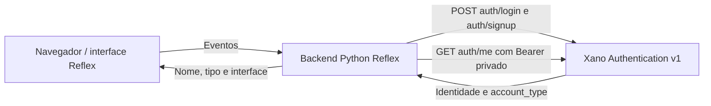

# Arquitetura do Pet Finder

## Visão e limites

O navegador apresenta componentes gerados pelo Reflex. Eventos são tratados pelo backend Python Reflex, que chama o Xano via HTTP assíncrono. O Xano mantém persistência e autenticação. Não há outro frontend nem integração de chat, catálogo ou quiz.

O token Xano permanece no backend. O diagrama não representa persistência entre acessos nem endpoints futuros.

## Organização física existente

| Arquivo / diretório | Responsabilidade |
|---|---|
| `Pet_Finder/Pet_Finder.py` | App, registro de rotas, tela de login |
| `Pet_Finder/auth.py` | `LoginState`, sessão privada transitória, guarda e logout |
| `Pet_Finder/home.py` | `HomeState`, menu desktop/mobile compartilhado e seções |
| `Pet_Finder/account_settings.py` | Componentes compartilhados da prévia somente leitura de configurações, sem novo estado ou HTTP |
| `Pet_Finder/register.py` | Formulários, estado e validações de cadastro |
| `Pet_Finder/services/xano.py` | Cliente assíncrono de login, identidade e cadastro |
| `rxconfig.py`, `requirements.txt` | Configuração Reflex e dependências |
| `xano/` | Cópias XanoScript; não publicadas ao iniciar o Reflex |
| `tests/` | Testes offline com mocks/estados locais |
| `docs/`, `openspec/` | Referências e planejamento, separados da implementação |

## Rotas e navegação

| Rota | Acesso | Comportamento |
|---|---|---|
| `/`, `/login` | Público | Tela de login existente |
| `/register` | Público | Cadastro com seleção ADOTANTE/ONG |
| `/home` | Protegido | `LoginState.require_auth` em `on_load`; conteúdo condicionado a `can_view_home` |

Início, ONGs, Pets, Quiz, Chats e Configurações são seções locais de `/home`, selecionadas por `HomeState.active_section`. Não existem rotas `/chats`, `/pets` ou `/ongs`. A navegação verifica a sessão privada no servidor e fecha o menu mobile. Ambos os menus reutilizam `_sidebar` e `_nav_item`, incluindo seleção, foco e hover. Chats herda essa proteção.

## Autenticação e sessão

1. O formulário envia e-mail/senha ao evento Reflex; senha não é variável pública de estado de login.
2. `authenticate` normaliza o e-mail, chama `POST auth/login` e valida `authToken`/`user_id`.
3. Consulta `GET auth/me` com Bearer e verifica identidade e `account_type` ADOTANTE/ONG.
4. Token, validade e identidade de autoridade ficam em variáveis privadas de `LoginState`; nome e tipo para UI são derivados da sessão válida.
5. Redireciona à Home existente; a guarda reconsulta `auth/me` ao entrar. Mostra carregamento até concluir a validação.
6. Eventos da Home verificam sessão local e expiração; não há revalidação remota em cada troca de seção nem polling.
7. Logout limpa a sessão local e redireciona ao login; não revoga o token remoto.

Validade local limitada a 24 horas desde o início do login; `auth/me` não prolonga o prazo. Falhas na guarda bloqueiam acesso. Mensagens de erro são sanitizadas; corpo HTTP, senha, cabeçalhos e token não devem ir para logs.

Não há token em cookie Reflex, localStorage ou JavaScript. Não há infraestrutura persistente com cookie opaco HttpOnly/Secure/SameSite e armazenamento compartilhado. Continuidade após reload depende da conservação do estado Reflex e sua revalidação, sem garantia entre abas, processos ou reinícios. Produção precisa de HTTPS/WSS e proteção do estado. Ver [login](login-integration.md).

## Perfis e cadastro

`account_type` vem da identidade autenticada; frontend e `role` não concedem permissões. Tipo ausente/inválido bloqueia o login, sem conversão automática de conta antiga. A Home usa a classificação para selecionar a prévia visual de Configurações de ADOTANTE/ONG, protegida também por `can_view_home`. Somente nome da sessão é preenchido; sem novo estado, armazenamento ou HTTP. Autorização de novas operações deverá existir no backend. Ver [prévia de configurações](account-settings-preview.md).

Cadastro envia campos comuns/específicos a `auth/signup`; sucesso não cria sessão Reflex automaticamente e informa que é necessário fazer login. Perfis JSON em `user` não significam edição de perfil ou busca pública implementada. Ver [contratos](xano-authentication-setup.md).

## Backend e evolução

Workspace 151970, live `v1`, plano Free sem branch isolada no ambiente atual. A publicação seletiva de autenticação/auditoria foi informada como concluída na Etapa 17; a Etapa 21 não consulta nem modifica recursos remotamente. Os contratos refletem código local e histórico informado, não nova certificação live.

RF-01 a RF-10 dependem de contratos aprovados, registrados em [requisitos](functional-requirements.md). Conceitos do [modelo de domínio](domain-model.md) não equivalem a tabelas existentes. Evoluir incrementalmente com componentes e [Design System](design-system.md) existentes.
